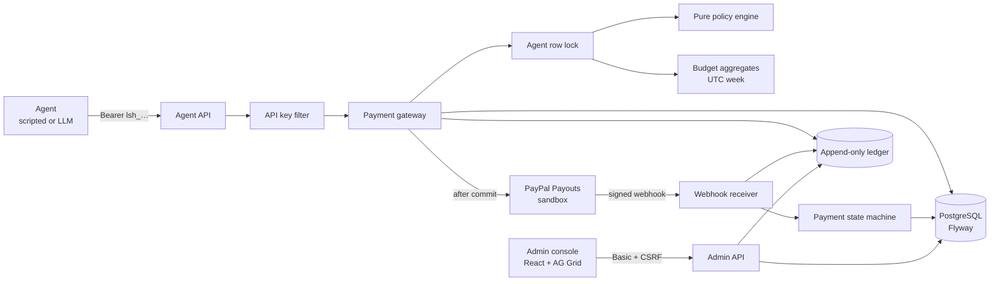

# Leash

**Spending controls for AI agents that pay with PayPal.**

Companies won't give an AI agent an open wallet. Leash sits between the agent and PayPal: the agent
asks to pay, Leash evaluates a human-owned policy, and only then may sandbox money move. Every
request, decision, reservation, submission, and status change is written to an append-only ledger.

> **Sandbox only. Not production-ready.** Leash never moves real money and refuses to boot against a
> non-sandbox PayPal host unless the owner explicitly overrides the guard. See
> [Limits](#12-limits) before drawing conclusions.

## 1. The problem

An agent that can call a payment API can empty an account. Prompt injection, a hallucinated invoice,
or a retry loop are enough. Bolting a `max_amount` check into the agent is not a control: the agent
owns the check.

Leash moves the control to a separate process the agent cannot edit:

| Decision | Meaning |
|---|---|
| **APPROVE** | Within every hard rule and at or below the auto-approve threshold. Leash submits a PayPal sandbox Payout. |
| **ESCALATE** | Within every hard rule but above the threshold. The payment reserves budget and waits for a human. |
| **DENY** | A hard rule failed. No money moves. Every reason is returned and ledgered. |

The policy is owned by the operator, not the agent: a weekly USD budget, an allow-list of payee
emails, an auto-approve threshold, and a hard per-payment cap. Suspending an agent takes effect on
the next decision. Approving an escalation re-runs the entire policy against the current budget.

## 2. Architecture



The request sequence is **commit the decision, then call PayPal**:

1. The agent authenticates with `Authorization: Bearer lsh_…` and sends `POST /api/v1/payments`
   with an `Idempotency-Key`.
2. In one short transaction, Leash locks the agent row, checks the idempotency replay, sums the
   week's spent and reserved budget, runs the pure policy engine, and persists the payment, any
   approval row, and the ledger facts. Then it commits.
3. Only after that commit does Leash call PayPal Payouts, outside every transaction. A second short
   transaction stores the batch id and moves `APPROVED → SUBMITTED`.
4. A transient PayPal failure leaves the payment `APPROVED`; the reconciler retries with the same
   payment id as the PayPal idempotency key. A definitive 4xx (except 429) marks it `FAILED`.
5. PayPal's signed webhook is verified over the raw request bytes, deduplicated by event id, and
   applied through the payment state machine. Out-of-order events cannot regress a terminal state.

See [`docs/architecture.md`](docs/architecture.md) for the full sequence diagrams, state machine,
data model, security boundaries, and failure table.

## 3. The demo in one minute

The `demo` profile provisions **Invoice Agent** and three invoice scenes. The agent runs in
`SCRIPTED` mode and calls Leash only over the public HTTP API with its own bearer key — it has no
service or database access.

| Invoice | Amount | Payee | Expected result |
|---|---|---|---|
| `inv-1201` | $12.00 | `alice@example.com` (allowed) | `APPROVE → APPROVED` (then `SUBMITTED` with PayPal credentials) |
| `inv-1502` | $150.00 | `alice@example.com` (allowed, above the $50 threshold) | `ESCALATE → PENDING_APPROVAL` |
| `inv-9003` | $900.00 | `mallory@example.com` (not allowed) | `DENY / PAYEE_NOT_ALLOWED` |

Every invoice reuses a stable `invoice-<id>` idempotency key, so a second run replays the same
payments and creates no second payout. Run it from the console's **Demo** section or:

```bash
curl -u admin:admin-test-password -c cookies.txt \
  http://localhost:8080/api/v1/admin/demo/status
XSRF=$(awk '/XSRF-TOKEN/ {print $7}' cookies.txt)
curl -u admin:admin-test-password -b cookies.txt \
  -H "X-XSRF-TOKEN: $XSRF" -X POST \
  'http://localhost:8080/api/v1/admin/demo/run?mode=SCRIPTED'
```

`LLM` mode is advertised but wired to fail closed with `501 LLM_NOT_CONFIGURED` in this build; see
[§10](#10-ai-model). The runner never calls a model in `SCRIPTED` mode.

## 4. Run from source

### Prerequisites

- Java 21 (`java -version` must report 21)
- Node.js 20+ and npm
- Docker Desktop or another Docker engine (local PostgreSQL 16, and Testcontainers for the test suite)
- No PayPal account is needed to run the policy, approval, ledger, and scripted demo flows

### 4.1 Start PostgreSQL

From the repository root:

```bash
docker compose up -d
docker compose ps          # leash-postgres should be healthy
```

The defaults match `docker-compose.yml`: database `leash`, user `leash`, password
`leash-local-only`. They are local-only values, not secrets.

### 4.2 Create the root `.env`

`backend/` imports `../.env` at startup. Copy `.env.example` and fill the values you have:

```properties
# PayPal sandbox (leave blank to run without money movement)
PAYPAL_CLIENT_ID=
PAYPAL_CLIENT_SECRET=
PAYPAL_BASE_URL=https://api-m.sandbox.paypal.com
PAYPAL_WEBHOOK_ID=

# Local admin credential. Hash below is BCrypt for "admin-test-password".
ADMIN_USERNAME=admin
ADMIN_PASSWORD_HASH=$2a$10$fJGOIu3FIJi7HVDAadwm9OCfwYvqb.1RZ.x70mCXeruUvTyVM5JNa

# Keep false while there are no PayPal credentials; enable for real sandbox runs.
LEASH_RECONCILER_ENABLED=false
```

`.env` is git-ignored. Never commit a real credential. Generate a different BCrypt hash for any
shared deployment; the hash above is a documented local test credential, not a production secret.

### 4.3 Start the backend

```bash
cd backend

# Windows PowerShell
$env:SPRING_PROFILES_ACTIVE='local,demo'
.\mvnw.cmd spring-boot:run

# macOS / Linux
SPRING_PROFILES_ACTIVE=local,demo ./mvnw spring-boot:run
```

`local` is the normal profile; `demo` adds the demo agent, demo runner routes, and the bundled
invoices. Without `demo`, the console hides the Demo section and the routes answer `404`.

Health check: <http://localhost:8080/actuator/health> → `{"status":"UP"}`.

### 4.4 Start the frontend

In a second terminal:

```bash
cd frontend
npm install
npm run dev
```

Open <http://localhost:5173>. Vite proxies `/api` and `/actuator` to `localhost:8080`, so the CSRF
cookie is first-party and no CORS configuration is required.

### 4.5 Sign in and run the demo

Use the local test credential:

| Field | Value |
|---|---|
| Username | `admin` |
| Password | `admin-test-password` |

The credential lives in module memory only; reloading the page signs the operator out. This is
deliberate for a sandbox console.

1. **Ledger** shows every payment, newest first. Click a row for its append-only timeline.
2. **Demo → Run the demo** executes the three invoices. Expect one approval, one escalation, one
   denial, and an unchanged budget on a second run.
3. **Approvals** lists the $150 escalation. Approve/reject opens a confirmation naming payee and
   amount; approving re-runs policy against the current budget. With no PayPal credentials the
   payment stays `APPROVED` and the reconciler can submit it later.
4. **Agents** shows the weekly budget and policy. **Edit policy** changes limits and the allow-list;
   a change is ledgered and applied to the next decision. The header selector's **Suspend/Resume**
   is the kill switch.

### 4.6 Tests and checks

```bash
# Backend: unit, integration (Testcontainers PostgreSQL + WireMock), Spotless, JaCoCo gate
cd backend
.\mvnw.cmd -B verify          # macOS/Linux: ./mvnw -B verify

# Frontend
cd frontend
npm run build                 # tsc -b && vite build
npm run lint
```

Docker must be running for the integration tests. The suite starts its own PostgreSQL container;
it does not touch the local `leash` database.

## 5. Agent API quickstart

Create an agent through the console, or with the admin API (CSRF-protected):

```bash
# 1. Prime the XSRF cookie
curl -s -c cookies.txt -u admin:admin-test-password \
  http://localhost:8080/api/v1/admin/agents
XSRF=$(awk '/XSRF-TOKEN/ {print $7}' cookies.txt)

# 2. Create an agent; the response contains the only plaintext API key
curl -s -b cookies.txt -u admin:admin-test-password \
  -H "X-XSRF-TOKEN: $XSRF" -H 'Content-Type: application/json' \
  -d '{"name":"Research Agent","weeklyLimitMinor":50000,"autoApproveThresholdMinor":5000,"allowedPayees":["alice@example.com"]}' \
  http://localhost:8080/api/v1/admin/agents
```

Then, with the returned `apiKey`:

```bash
curl -s -H 'Authorization: Bearer lsh_…' \
  -H 'Idempotency-Key: invoice-1' -H 'Content-Type: application/json' \
  -d '{"payeeEmail":"alice@example.com","amountMinor":1200,"currency":"USD","memo":"Invoice 1"}' \
  http://localhost:8080/api/v1/payments
```

A denial is still HTTP `201`; inspect `decision.outcome` and `decision.reasons`. A replay of the same
key and body returns the stored payment and `Idempotent-Replayed: true`. Reusing a key with a
different body returns `422 IDEMPOTENCY_KEY_REUSED`.

## 6. PayPal sandbox setup

The owner guide is [`docs/paypal-sandbox-setup.md`](docs/paypal-sandbox-setup.md). In short:

1. Create a PayPal developer account with one Business and three Personal sandbox accounts.
2. Create a sandbox REST app; confirm **Payouts** is enabled.
3. Put `PAYPAL_CLIENT_ID` and `PAYPAL_CLIENT_SECRET` in `.env`; keep
   `PAYPAL_BASE_URL=https://api-m.sandbox.paypal.com`.
4. Run the reconciler with credentials available. The parked `$12` approval can then submit.
5. Register `https://<host>/webhooks/paypal` for `PAYMENT.PAYOUTS-ITEM.*` events and set
   `PAYPAL_WEBHOOK_ID`.

Without credentials, an approved payment is **not failed**: it stays `APPROVED` with no PayPal ids,
and the reconciler retries once credentials exist. This is a deliberate crash-safety property, not a
simulation of a successful payout.

## 7. Configuration

| Variable | Default | Meaning |
|---|---|---|
| `SPRING_PROFILES_ACTIVE` | `local` | Use `local,demo` for the demo runner |
| `PORT` | `8080` | HTTP port |
| `DB_HOST`, `DB_PORT`, `DB_NAME`, `DB_USER`, `DB_PASSWORD` | compose defaults | PostgreSQL connection |
| `ADMIN_USERNAME` | — (required) | Admin username; startup fails if blank |
| `ADMIN_PASSWORD_HASH` | — (required) | BCrypt hash only; startup fails if not a valid hash |
| `LEASH_MAX_PAYMENT_MINOR` | `100000` | Hard per-payment cap ($1,000.00) |
| `PAYPAL_CLIENT_ID`, `PAYPAL_CLIENT_SECRET` | blank | Sandbox OAuth credentials |
| `PAYPAL_BASE_URL` | `https://api-m.sandbox.paypal.com` | Must be a sandbox host unless `LEASH_ALLOW_LIVE=true` |
| `PAYPAL_WEBHOOK_ID` | blank | Webhook signature verification id |
| `LEASH_ALLOW_LIVE` | `false` | Safety guard; never enable for this project |
| `LEASH_RECONCILER_ENABLED` | `true` | Retry parked submissions and poll stale ones |
| `LEASH_RECONCILER_INTERVAL` | `30s` | Scheduler interval |
| `LEASH_DEMO_AGENT_NAME` | `Invoice Agent` | Demo agent matched/created by name |
| `LEASH_DEMO_WEEKLY_LIMIT_MINOR` | `200000` | Demo weekly limit ($2,000.00) |
| `LEASH_DEMO_AUTO_APPROVE_THRESHOLD_MINOR` | `5000` | Demo threshold ($50.00) |
| `LEASH_DEMO_ALLOWED_PAYEE` | `alice@example.com` | Demo allow-list |

The `LEASH_LLM_*` placeholders in `.env.example` are reserved for the unimplemented LLM mode; setting
them does not enable it. Money is integer minor units end to end. The only decimal conversion happens at the PayPal adapter
boundary.

## 8. What is new since October 1, 2026

Everything in this repository was built for this submission after October 1, 2026. There is no
pre-existing product code:

- Agent registry with one-time API keys, suspend/resume, key rotation, and policy edits.
- Pure policy engine with a fixed rule order, all violations collected, UTC Monday weeks, and
  reservation-aware budgets.
- Committed-before-PayPal payment gateway with per-agent idempotency and a reconciler.
- PayPal sandbox Payouts adapter with OAuth token caching, bounded retries, and exhaustive status
  mapping.
- Raw-body webhook verification and event dedupe.
- Append-only ledger enforced by PostgreSQL triggers, with a redacting payload guard.
- Approval workflow with a full policy re-check, idempotent decisions, and race-safe locking.
- React + TypeScript console with an AG Grid ledger, timeline drawer, approvals, budget bars, kill
  switch, policy editor, and demo runner.
- Deterministic demo agent that uses only the public HTTP API.

## 9. Sponsor and open-source tools

| Tool | How it is used |
|---|---|
| **PayPal Payouts (sandbox)** | The only money rail: OAuth client credentials, one payout item per payment, `PayPal-Request-Id` idempotency, batch status lookup, signed webhooks. |
| **AG Grid Community 36.3** | Operator ledger: server-side paging, column filters, quick filter, sorting, custom cells, shared quartz theme with light/dark params, keyboard row activation. |
| **Render** | A `render.yaml` blueprint and multi-stage `Dockerfile` are prepared for one web service plus PostgreSQL. The image was built and smoke-tested locally, but no public Render URL is claimed because no Render account was available to deploy it. Run-from-source is the verified path. |

Stack: Java 21, Spring Boot 4.1.2, Spring Framework 7, Spring Security 7, PostgreSQL 16, Flyway,
React 19, TypeScript 7 strict, Vite 8, TanStack Query 5, AG Grid 36.

## 10. AI model

**No LLM provider or model is called in this build.** The demo agent runs in `SCRIPTED` mode, which
makes deterministic tool calls in invoice order and is the safety net for the demo. `LLM` mode is
listed in the demo status response but disabled in the console; a direct call returns
`501 LLM_NOT_CONFIGURED`. This is intentional: the policy engine, not a model, owns every decision,
and the project boots and passes its tests with no model key present.

Adding a model later is a port-level change: the agent must still call Leash over HTTP with its own
key, and model output remains untrusted input that cannot bypass policy or read PayPal credentials.

## 11. Verification

Recorded on 2026-11-12:

- Backend `.\mvnw.cmd -B verify`: **BUILD SUCCESS**, **364 tests**, 0 failures, 0 errors, 0 skipped.
- Spotless: **199 Java files clean**.
- JaCoCo policy gate: **97.5% line coverage** (115/118), minimum 90%.
- Frontend `npm run build`: TypeScript strict pass, 93 modules, 1,522.12 kB JS / 431.84 kB gzip,
  32.05 kB CSS / 6.55 kB gzip.
- Frontend `npm run lint`: clean.
- Live browser pass: sign-in, ledger filters and paging, payment timeline, approval confirmation and
  approval, policy editor save, suspend/resume, demo navigation, mode gating, and a scripted demo
  run whose second execution replayed all three payments with no budget change.
- Multi-stage Docker image: built locally as `leash:local` (572 MB) and run against a fresh
  PostgreSQL database. The container applied all five Flyway migrations, served the packaged console
  and hashed assets from the jar, returned `UP` on `/actuator/health`, rejected unauthenticated admin
  and agent calls with `401`, and completed a CSRF-protected scripted demo (`$12` approved, `$150`
  escalated, `$900` denied). A second run replayed all three payments with an unchanged budget, and
  the packaged console was signed into through a browser.
- **Not verified in this environment:** a real sandbox payout and a live PayPal webhook, because no
  `PAYPAL_CLIENT_ID` / `PAYPAL_CLIENT_SECRET` / `PAYPAL_WEBHOOK_ID` were available. The adapter and
  webhook paths are covered by WireMock tests, but that is not a substitute for Gate G1.

## 12. Limits

Leash is a hackathon sandbox control plane, **not production-ready**:

- PayPal Payouts sandbox only. No live credentials, no real money, and a startup guard rejects a
  non-sandbox base URL.
- USD only; one payout item per payment request.
- Single-tenant. No organizations, teams, SSO, MFA, or per-operator roles.
- No rate limiting, abuse detection, or external notification channel. The approval queue lives in
  the dashboard.
- No data-retention or archival policy. The ledger is append-only by design, so a reset requires a
  schema drop in a local database.
- The admin credential is one in-memory user; the console keeps it in module memory and a reload
  signs out.
- The reconciler is a single scheduled loop. Database row locks protect decisions across instances,
  but the scheduler is not coordinated for horizontal scaling.
- The frontend ships AG Grid in one ~1.5 MB bundle; it is an operator console, not a public site.
- LLM tool calling is not implemented in this build; `SCRIPTED` mode is the demo path.

## 13. Documentation

- [`docs/architecture.md`](docs/architecture.md) — request flow, decision flow, state machine, data
  model, security boundaries, failure behaviour.
- [`docs/PROGRESS.md`](docs/PROGRESS.md) — what is done, assumptions, findings, blockers, next steps.
- [`docs/IMPLEMENTATION_PLAN.md`](docs/IMPLEMENTATION_PLAN.md) — the slice plan.
- [`docs/paypal-sandbox-setup.md`](docs/paypal-sandbox-setup.md) — owner setup guide.
- [`docs/gate-g1-runbook.md`](docs/gate-g1-runbook.md) — the one real `$1.00` sandbox payout check.
- [`docs/demo-script.md`](docs/demo-script.md) — timed video shot list and preflight.
- [`docs/submission-description.md`](docs/submission-description.md) — copy-paste submission and
  YouTube text, with an honesty table.
- [`docs/submission-checklist.md`](docs/submission-checklist.md) — done/blocked/owner-only items.
- [`docs/decisions/`](docs/decisions/) — ADR 001 (Payouts rail), 002 (status mapping), 003 (LLM
  deferred).

## 14. License

MIT. See [`LICENSE`](LICENSE). The copyright holder line is a placeholder until the repository
owner confirms the name for the public submission.

---

Sandbox only. Never use live PayPal credentials. Never commit `.env`. If a secret leaks, rotate it;
deleting the commit is not enough.
