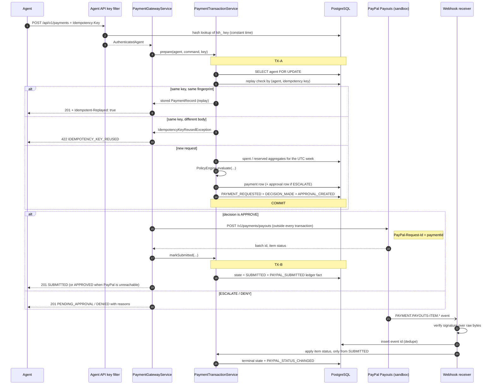
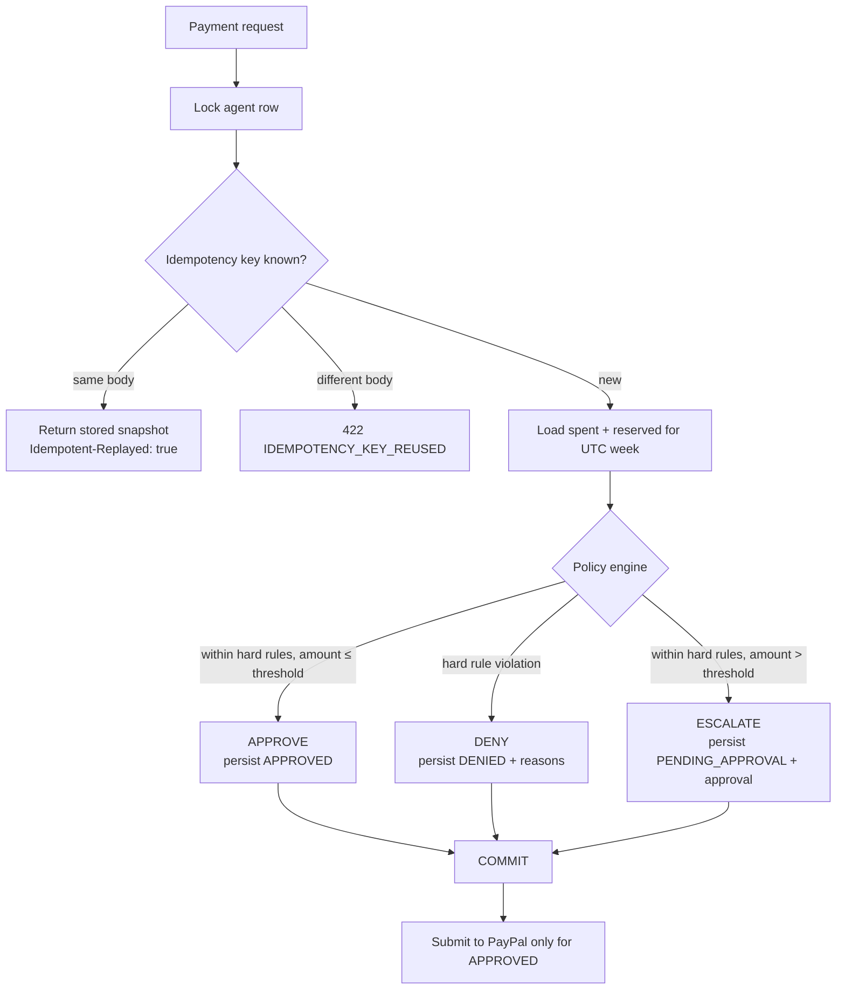
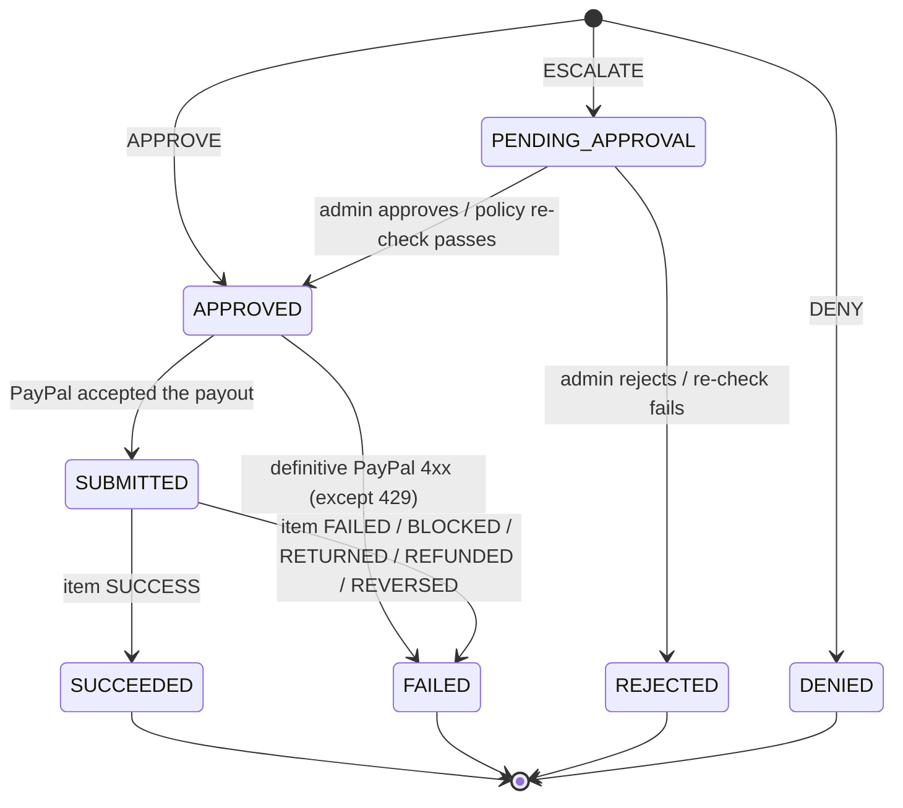
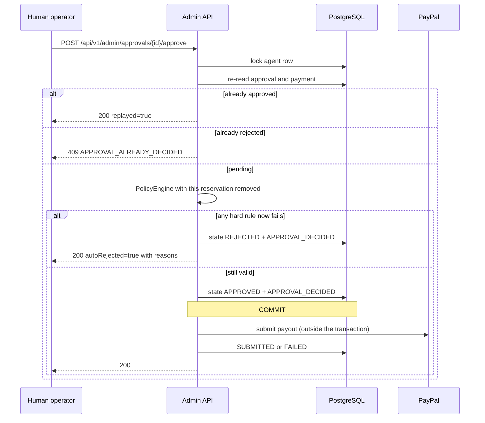

# Architecture

Leash is one deployable modular monolith. The React console and the demo agent are HTTP
clients; no browser or agent code reaches a database, a service bean, or a PayPal credential.

```
Agent (scripted, or an external LLM agent)
   │  Authorization: Bearer lsh_…
   ▼
Leash backend ── policy engine ── budget ledger ── payment state machine
   │
   └── PayPal Payouts (sandbox) ── signed webhook ──► /webhooks/paypal
```

## 1. Components

| Component | Responsibility | Entry point |
|---|---|---|
| Admin console | Ledger grid, approvals, budget bars, kill switch, policy editor, demo runner | `frontend/src` |
| Agent API | Authenticated payment creation, payment lookup, budget read | `com.leash.payment.api`, `com.leash.agent.api` |
| Admin API | Agent registry, policy edits, paged payments, timelines, approvals, demo control | `/api/v1/admin/**` |
| Policy engine | Pure Java, fixed rule order, all violations collected | `com.leash.policy` |
| Payment gateway | Commit decision first, then call PayPal, then record submission | `PaymentGatewayService` |
| Payment transaction service | Row locks, idempotency, budget aggregates, state transitions, ledger writes | `PaymentTransactionService` |
| PayPal adapter | OAuth token cache, Payouts submit, batch status lookup, webhook signature verification | `com.leash.paypal` |
| Webhook receiver | Raw-body verification, event dedupe, item-status application | `com.leash.webhook` |
| Reconciler | Retry stuck `APPROVED` submissions, poll stale `SUBMITTED` payments | `PaymentReconciler` |
| Ledger | Append-only audit facts, enforced by database triggers | `com.leash.ledger` |
| Demo agent | Calls Leash only over public HTTP with its own key | `com.leash.demoagent` |

The backend package layout is `api → app → domain → infra`. Dependencies point inward. A feature
talks to another feature through an app service, never through another feature's repository.

## 2. Payment request flow



Key invariants:

1. **The decision commits before PayPal is called.** A crash or network failure between TX-A and
   submission leaves the payment `APPROVED`; the reconciler finishes it with the same payment id as
   the PayPal idempotency key.
2. **The agent row is the budget lock.** Every decision, approval, policy edit, suspend, and resume
   takes `PESSIMISTIC_WRITE` on that agent first. This gives one lock order and serializes budget
   checks for the agent.
3. **Idempotency is per agent.** The fingerprint is SHA-256 over fixed fields (`payeeEmail`,
   `amountMinor`, `currency`, `memo`). A replay returns the stored snapshot; a different body on the
   same key is `422`.
4. **Budget arithmetic saturates.** Spent and reserved are summed as minor units and cannot overflow.
5. **Only the payment state machine transitions states.** Illegal transitions throw and roll back
   the surrounding transaction.

## 3. Decision flow



Hard-rule order (all violations are collected; the first is the primary reason):

| # | Rule | Reason |
|---|---|---|
| 1 | Agent is ACTIVE | `AGENT_SUSPENDED` |
| 2 | Currency is USD | `CURRENCY_NOT_SUPPORTED` |
| 3 | Amount is positive | `INVALID_AMOUNT` |
| 4 | Amount ≤ hard cap ($1,000.00 default) | `AMOUNT_EXCEEDS_CAP` |
| 5 | Payee is on the normalized allow-list | `PAYEE_NOT_ALLOWED` |
| 6 | `spent + reserved + amount ≤ weekly limit` | `BUDGET_EXCEEDED` |

The budget period is the UTC calendar week: Monday 00:00:00 UTC inclusive to the next Monday
exclusive. Spent is `APPROVED + SUBMITTED + SUCCEEDED`; reserved is `PENDING_APPROVAL`; `DENIED`,
`REJECTED`, and `FAILED` release their reservation.

## 4. Payment state machine



Rules enforced by `PaymentStateMachine`:

- Terminal states never move, even for out-of-order webhooks or reconciler retries.
- A webhook may only move `SUBMITTED` forward.
- The reconciler only retries `APPROVED` submissions (older than 60 s) and polls `SUBMITTED`
  payments (older than 10 minutes).
- A transient PayPal failure leaves the payment `APPROVED`. Only a definitive 4xx (except 429)
  marks it `FAILED`.
- Every transition writes a ledger fact in the same transaction.

## 5. PayPal status mapping

The **item transaction status is authoritative**. A batch status of `SUCCESS` only means the batch
finished processing; its items can still be `ONHOLD` or `UNCLAIMED`.

| PayPal input | Leash state |
|---|---|
| item `SUCCESS` | `SUCCEEDED` |
| item `FAILED`, `BLOCKED`, `RETURNED`, `REFUNDED`, `REVERSED` | `FAILED` |
| item `PENDING`, `UNCLAIMED`, `ONHOLD`, unknown | `SUBMITTED` (fail safe) |
| batch `SUCCESS` with no item status | `SUBMITTED` |
| batch `DENIED` / `CANCELED` | `FAILED` |

Raw PayPal strings are stored so the audit trail keeps PayPal's exact vocabulary. See
[`decisions/002-payout-status-mapping.md`](decisions/002-payout-status-mapping.md).

## 6. Webhooks

`POST /webhooks/paypal` is public but signature-verified:

1. Read the raw body bytes before any JSON parsing.
2. Call PayPal's `verify-webhook-signature` with the transmission headers, the configured webhook
   id, and the raw event JSON verbatim.
3. Unverified → `400`; nothing is persisted.
4. Dedupe by PayPal event id (`webhook_events` primary key). Duplicate → `200`, no-op.
5. Persist the raw event, then apply the payout item status through `PayPalStatusMapper` and
   `PaymentStateMachine`.
6. Out-of-order events cannot move a terminal state backward. An event that arrives before the
   payment is `SUBMITTED` is left unprocessed and retried by a redelivery.

See [`decisions/003-webhook-raw-body-verification.md`](decisions/003-webhook-raw-body-verification.md).

## 7. Approvals and the kill switch



- Rejecting releases the reservation and is idempotent.
- Suspend is immediate for new decisions: the policy engine returns `AGENT_SUSPENDED`. A payout
  already submitted to PayPal is not recalled.
- Policy edits are written to the ledger and take effect on the next decision. Pending approvals are
  re-checked against the new policy when a human decides.

## 8. Data model

| Table | Purpose |
|---|---|
| `agents` | Identity and ACTIVE / SUSPENDED status |
| `policies` | Weekly limit, auto-approve threshold, currency |
| `policy_payees` | Normalized allowed emails |
| `api_keys` | SHA-256 hash, 8-character prefix, revocation time |
| `payment_requests` | Request fields, decision snapshot, state, PayPal ids, `@Version` |
| `approvals` | One per escalated payment: PENDING / APPROVED / REJECTED, note, decider |
| `ledger_events` | Append-only business facts, trigger-protected |
| `webhook_events` | PayPal event id, raw body, processed time |

`ledger_events` deliberately has no foreign keys: deleting an agent or payment must not delete or
block its audit history. See [`decisions/004-append-only-ledger.md`](decisions/004-append-only-ledger.md).

## 9. Security boundaries

| Boundary | Authentication | Authorization |
|---|---|---|
| `/api/v1/payments`, `/api/v1/payments/**`, `/api/v1/budget` | `Authorization: Bearer lsh_…` | owning `AGENT` only; another agent's payment is `404` |
| `/api/v1/admin/**` | HTTP Basic with a BCrypt credential | `ROLE_ADMIN`; CSRF on every write |
| `/webhooks/paypal` | PayPal signature over raw body | verified event only |
| `/actuator/health`, `/actuator/info` | none | read-only |

Two ordered security chains exist on purpose. The agent key filter never runs on admin routes, and
an agent key cannot authenticate an admin request. Agent API keys are stored only as SHA-256 hashes
plus an 8-character prefix; comparison is constant time.

Admin CSRF uses Spring Security's SPA cookie repository: the server emits a readable `XSRF-TOKEN`
cookie, and the console mirrors it in `X-XSRF-TOKEN`. Any admin `401` clears the in-memory
credential and returns the operator to the sign-in screen.

## 10. Failure behaviour

| Failure | Result |
|---|---|
| PayPal unreachable, timeout, 5xx, 429 | Payment stays `APPROVED`; reconciler retries with the same idempotency key |
| PayPal definitive 4xx (except 429) | Payment becomes `FAILED`; no retry |
| Missing OAuth configuration | Payment stays `APPROVED`; submission is deferred until credentials exist |
| Crash after TX-A, before submission | Reconciler submits the `APPROVED` payment after 60 s |
| Webhook arrives before submission | Event stored unprocessed; redelivery applies it after `SUBMITTED` |
| Duplicate webhook | `200`, no state change |
| Concurrent same-key requests | One payment, one PayPal call, one replay |
| Concurrent approvals | Agent-row lock yields one winner; opposite decisions return `409` |

## 11. Ledger and observability

The ledger is the dashboard timeline and the audit trail. Writes use `Propagation.MANDATORY`, so a
business change and its ledger fact commit or roll back together. Payloads are rejected if they
contain tokens, secrets, passwords, hashes, or values shaped like agent keys. The database rejects
`UPDATE`, `DELETE`, and `TRUNCATE` on `ledger_events`.

The payment id is the correlation id for a payment flow. Health is exposed at
`/actuator/health`; details are never shown. Logs name business events at INFO, handled surprises at
WARN, and attention-needed failures at ERROR. API keys, bearer tokens, passwords, and
`Authorization` headers are never logged.
